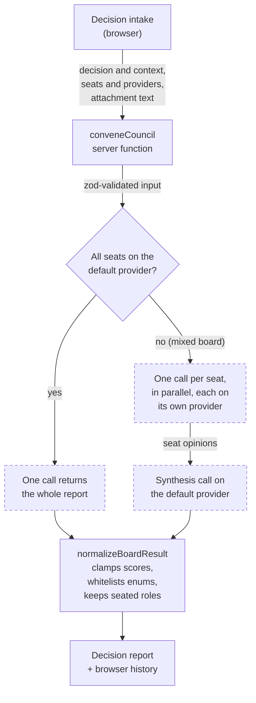

# Quorum: AI Boardroom

> Stress-test any business decision against a five-seat AI executive council before you commit to it.

Quorum is a self-hostable web app for founders and managers who want a second (and third, and
fourth) opinion on a hard call. Describe a decision (a pricing change, a key hire, a new product
tier) and Quorum convenes a board of five AI executives who vote, argue and deliver a structured
decision report: a verdict, scores, boardroom tensions, a pre-mortem and measurable guardrails. Then
challenge the board with a new constraint and watch the votes shift.

Bring your own API key for **OpenAI**, **Anthropic** or **Google Gemini** (or any OpenAI-compatible
endpoint). Each seat on the board can run on a different provider.

> [!NOTE]
> Quorum's output is AI-generated and can be wrong. Treat it as a thinking aid, not as financial, legal or other professional advice.

## Contents

- [Features](#features)
  - [The council](#the-council)
- [Quick start](#quick-start)
- [Configuration](#configuration)
  - [AI providers](#ai-providers)
  - [Council behaviour and access](#council-behaviour-and-access)
  - [How providers are used](#how-providers-are-used)
  - [OpenAI-compatible endpoints](#openai-compatible-endpoints)
- [Deploying](#deploying)
  - [Node.js (default)](#nodejs-default)
  - [Cloudflare Workers](#cloudflare-workers)
  - [Other hosts](#other-hosts)
- [Security](#security)
- [Data and privacy](#data-and-privacy)
- [How it works](#how-it-works)
  - [Report contract](#report-contract)
- [Project structure](#project-structure)
  - [Tech stack](#tech-stack)
- [Development](#development)
- [Contributing](#contributing)
- [Acknowledgements](#acknowledgements)
- [License](#license)

## Features

- **Decision intake**: a free-text decision plus its context (company stage, budget at stake, risk
  appetite and time horizon). Three one-click sample decisions, and a "Run Sample Decision" button
  so first-time visitors see a result in one click.
- **Configurable council**: toggle any of the five seats on or off and pick the AI provider for
  each seat.
- **Live deliberation**: a step-by-step progress tracker while the board works. Rate limits,
  provider outages and bad configuration surface as friendly, retryable messages.
- **Executive decision report**
  - Verdict banner (APPROVED / CONDITIONAL APPROVAL / REJECTED), vote tally, consensus score
    (0–100) and executive summary.
  - Four-axis radar chart: financial viability, market upside, execution feasibility, risk safety.
  - Member cards: vote, confidence, thesis, #1 dealbreaker, required condition, and the provider
    and model that answered.
  - Boardroom tension map: 2–3 explicit "Role A vs. Role B" clashes.
  - 12-month pre-mortem: "If this fails in 12 months, here is why."
  - Guardrails and kill criteria as an interactive checklist (metric / threshold / timeframe).
- **Challenge the board (re-vote)**: add a counter-argument or constraint ("Run a 30-day pilot
  with 10% of budget") and the council re-votes. A Board Shift banner shows the consensus delta,
  every seat that changed its vote and a short explanation; toggle between round 1 and round 2.
- **Supporting documents**: attach a PDF, Word (.docx), TXT, Markdown, CSV or JSON file (up to
  5 MB / 30,000 characters). Text is extracted in the browser; the file itself is never uploaded.
- **Export and history**: copy a Markdown board memo, print a clean light-background PDF brief,
  and reopen or delete past decisions from a history drawer (stored in your browser).
- **Responsive**: a single-workspace layout that works on phones; the intake panel collapses
  once a report is ready.

### The council

| Seat                                  | Short    | Lens                                                            |
| ------------------------------------- | -------- | --------------------------------------------------------------- |
| Chief Financial Officer               | CFO      | Unit economics, CAC payback, gross margin, cash runway          |
| Chief Marketing Officer               | CMO      | Positioning, demand generation, brand and competitive narrative |
| Chief Operating Officer               | COO      | Ownership, team capacity, sequencing, operational load          |
| Chief Risk Officer · Devil's Advocate | CRO      | Attacks weak assumptions; names the most likely failure mode    |
| Customer Advocate                     | Customer | Perceived value, trust, churn, fairness                         |

## Quick start

**Prerequisites:** Node.js `^20.19` or `>=22.12`, and an API key for at least one of OpenAI,
Anthropic or Google Gemini. [Bun](https://bun.sh) is recommended because the repository ships a
`bun.lock`, but npm works too.

```sh
git clone https://github.com/SuienS/quorum-ai-boardroom.git
cd quorum-ai-boardroom
bun install            # or: npm install

cp .env.example .env   # then add at least one API key
bun run dev            # or: npm run dev
```

Open <http://localhost:3000>. If no API key is configured, the intake panel tells you so and the
Convene button stays disabled.

## Configuration

All configuration is done with server-side environment variables. In development they are read
from `.env` (git-ignored); in production set them in your host's environment or secrets manager.
None of them are sent to the browser: the UI only learns which providers are enabled and their
model ids.

### AI providers

A provider is enabled when its API key is set. Model and base URL are optional.

| Variable                            | Default                                                   | Notes                                      |
| ----------------------------------- | --------------------------------------------------------- | ------------------------------------------ |
| `OPENAI_API_KEY`                    | none                                                      | Enables the OpenAI provider                |
| `OPENAI_MODEL`                      | `gpt-6-astra`                                             |                                            |
| `OPENAI_BASE_URL`                   | `https://api.openai.com/v1`                               | Any OpenAI-compatible endpoint (see below) |
| `ANTHROPIC_API_KEY`                 | none                                                      | Enables the Anthropic provider             |
| `ANTHROPIC_MODEL`                   | `claude-sonnet-5-5`                                       |                                            |
| `ANTHROPIC_BASE_URL`                | `https://api.anthropic.com`                               |                                            |
| `GEMINI_API_KEY` / `GOOGLE_API_KEY` | none                                                      | Enables the Google provider                |
| `GEMINI_MODEL`                      | `gemini-3.8-flash`                                        |                                            |
| `GEMINI_BASE_URL`                   | `https://generativelanguage.googleapis.com/v1beta/openai` | Gemini's OpenAI-compatible endpoint        |

### Council behaviour and access

| Variable                  | Default                   | Notes                                                                                                    |
| ------------------------- | ------------------------- | -------------------------------------------------------------------------------------------------------- |
| `QUORUM_DEFAULT_PROVIDER` | first configured provider | `openai`, `anthropic` or `google`. Used for seats without an explicit choice, synthesis and fallback.    |
| `QUORUM_TIMEOUT_MS`       | `120000`                  | Per-request timeout for AI calls (1000–600000).                                                          |
| `QUORUM_BASIC_AUTH`       | unset (app is open)       | `username:password`. Requires HTTP Basic Auth for every page and server call. See [Security](#security). |
| `PORT` / `HOST`           | `3000` / all interfaces   | Production Node server only.                                                                             |

If a value is invalid (for example a malformed base URL), the affected setting is ignored and a
warning appears in the intake panel; the app does not crash.

### How providers are used

- **Single-provider board**: when every seat runs on the default provider, the whole report comes
  back from one call. On OpenAI this uses strict JSON-schema structured outputs.
- **Mixed board**: each seat is asked separately on its own provider (in parallel), then the
  default provider synthesises the verdict, scores, tensions, pre-mortem and guardrails from the
  seat opinions.
- **Fallback**: if a seat's provider fails or has no key, that seat is answered by the default
  provider and its card is marked with an asterisk.

Anthropic and Gemini are prompted to return JSON that matches the schema; every response from every
provider is re-validated on the server before it reaches the UI.

### OpenAI-compatible endpoints

`OPENAI_BASE_URL` can point the OpenAI provider at any server that implements the Chat Completions
API with structured outputs (`response_format` of type `json_schema`), such as OpenRouter or a local
Ollama, vLLM or LM Studio server. Set `OPENAI_MODEL` to a model that server offers. Local servers
usually ignore the key, but `OPENAI_API_KEY` must be non-empty to enable the provider.

```sh
# OpenRouter
OPENAI_BASE_URL=https://openrouter.ai/api/v1
OPENAI_API_KEY=sk-or-...
OPENAI_MODEL=<an OpenRouter model id>

# Local Ollama
OPENAI_BASE_URL=http://localhost:11434/v1
OPENAI_API_KEY=ollama
OPENAI_MODEL=<a model you have pulled>
```

Smaller local models may not follow the board schema reliably; the server rejects unusable output
with a "couldn't be read" message rather than showing a broken report.

## Deploying

Quorum is a [TanStack Start](https://tanstack.com/start) app. Production builds go through
[Nitro](https://nitro.build), which can target many hosts.

### Node.js (default)

```sh
bun run build                     # or: npm run build
node --env-file=.env .output/server/index.mjs
```

`npm start` / `bun run start` runs the same server without loading `.env`, for hosts that inject
environment variables themselves. The `.output/` directory is self-contained, so you can copy it
into a minimal Node.js container image.

### Cloudflare Workers

```sh
NITRO_PRESET=cloudflare-module bun run build
npx nitro deploy --prebuilt
```

Nitro generates a Wrangler config with `nodejs_compat` enabled. Add your provider keys (and
`QUORUM_BASIC_AUTH`) as Worker secrets, either with `wrangler secret put` or in the Cloudflare
dashboard.

### Other hosts

Set `NITRO_PRESET` to another [Nitro preset](https://nitro.build/deploy) (for example `vercel` or
`netlify`); on those platforms Nitro usually detects the preset automatically. Whatever the host,
configure the environment variables above as server-side secrets.

## Security

- **Protect public deployments.** By default the app has no login, and every council run spends
  credits on _your_ API keys. On any deployment reachable from the internet, set
  `QUORUM_BASIC_AUTH`, or put the app behind your own authentication (an identity-aware proxy,
  Cloudflare Access, a VPN). Basic Auth is only safe over HTTPS. It guards every page and server
  function; static build assets (JavaScript, CSS, icons) stay public, which is fine because they
  contain no secrets.
- **Keys stay on the server.** Provider keys are read from the server environment only, never
  bundled into client code, and never returned in responses. Provider error details are logged on
  the server; users only see generic messages. Outbound provider requests do not follow redirects,
  so a misconfigured base URL can't bounce your key to another host.
- **Untrusted input and output.** Requests are validated with zod (length-bounded text, enum
  fields). Attachment text is passed to the models labelled as _untrusted evidence, not
  instructions_. Model output is re-validated and clamped by `normalizeBoardResult` before
  rendering, and React escapes all rendered text.
- **CSRF.** Server functions are protected by TanStack Start's CSRF middleware (same-origin only).
- **Never commit secrets.** `.env`, `.env.*` and `.dev.vars` are git-ignored; only `.env.example`
  is tracked.

**Reporting a vulnerability:** please don't open a public issue. Use GitHub's
[private vulnerability reporting](https://github.com/SuienS/quorum-ai-boardroom/security/advisories/new)
for this repository instead.

## Data and privacy

- **No accounts and no database.** Decisions, reports and guardrail check-states live only in your
  browser's `localStorage` (key `quorum.history.v2`, last 30 decisions). Clearing site data
  removes them.
- **Attachments never leave the device as files.** Text is extracted in the browser; only the
  extracted text (at most 30,000 characters) is sent with the request.
- **What is sent to AI providers.** The decision text, its context, any attachment text and, on a
  re-vote, the previous round and your challenge. They go to the providers you configured, under
  your account's data-handling terms. Quorum's server does not store them.
- **Fonts.** The UI loads Newsreader, IBM Plex Sans and IBM Plex Mono from Google Fonts, so
  visitors' browsers contact `fonts.googleapis.com` / `fonts.gstatic.com`. Self-host the fonts if
  that matters for your deployment.

## How it works



Dashed boxes are calls to the AI providers, made with plain `fetch` from `council-models.server.ts`.
A seat whose provider fails or has no key is answered by the default provider instead.

### Report contract

Every response is normalised into this shape before it reaches the UI:

```jsonc
{
  "verdict": "APPROVED | CONDITIONAL APPROVAL | REJECTED",
  "consensusScore": 0-100,
  "executiveSummary": "string",
  "scores": {
    "financialViability": 0-100,
    "marketUpside": 0-100,
    "executionFeasibility": 0-100,
    "riskSafety": 0-100
  },
  "members": [
    { "role": "cfo", "vote": "approve | conditional | reject", "confidence": 0-100,
      "thesis": "...", "dealbreaker": "...", "condition": "...",
      "provider": "openai", "model": "gpt-6-astra" }
  ],
  "tensions": [{ "sideA": "cfo", "sideB": "cmo", "conflictSummary": "..." }],
  "preMortem": "string",
  "guardrails": [{ "metric": "...", "threshold": "...", "timeframe": "..." }]
}
```

The board is instructed to derive the verdict from the votes: a majority approve with at most one
reject is APPROVED; rejects from at least half the board is REJECTED; anything else is CONDITIONAL
APPROVAL. A re-vote round adds a `shiftSummary`.

## Project structure

```text
src/
├── routes/
│   ├── __root.tsx                 # HTML shell, fonts, toaster, error and 404 pages
│   └── index.tsx                  # Workspace: intake, deliberation, report, history drawer
├── components/
│   ├── quorum/
│   │   ├── Report.tsx             # Verdict, radar chart, member cards, tensions, guardrails, export
│   │   └── Challenge.tsx          # Re-vote panel and Board Shift banner
│   └── ui/                        # shadcn/ui primitives
├── lib/
│   ├── council.ts                 # Shared types, seats, presets, normalizeBoardResult, board memo
│   ├── council.functions.ts       # Server functions: getCouncilConfig, conveneCouncil (prompts)
│   ├── council-models.server.ts   # Env config + OpenAI / Anthropic / Gemini HTTP clients (server only)
│   ├── attachments.ts             # File validation and in-browser text extraction
│   ├── basic-auth.ts              # Optional HTTP Basic Auth check
│   └── *.test.ts                  # Unit tests
├── start.ts                       # Request middleware: errors, Basic Auth, CSRF
├── server.ts                      # SSR entry with a friendly error page
├── styles.css                     # Tailwind v4 theme tokens, glass cards, print styles
└── routeTree.gen.ts               # Generated by TanStack Router (don't edit)
```

### Tech stack

TanStack Start (React 19, SSR, server functions) on Vite 8 and Nitro · TypeScript (strict) ·
Tailwind CSS v4 with shadcn/ui-style components · zod · Recharts · pdf.js and mammoth for documents
· lucide-react icons · sonner toasts · Vitest.

## Development

| Command             | What it does                                          |
| ------------------- | ----------------------------------------------------- |
| `bun run dev`       | Dev server with hot reload on <http://localhost:3000> |
| `bun run build`     | Production build into `.output/`                      |
| `bun run start`     | Run the production build                              |
| `bun run test`      | Unit tests (Vitest)                                   |
| `bun run typecheck` | TypeScript, no emit                                   |
| `bun run lint`      | ESLint + Prettier check                               |
| `bun run format`    | Format everything with Prettier                       |

(Use `npm run <script>` if you use npm.)

Tests run without API keys or network access. They cover vote tallying, normalisation of malformed
model output, vote-shift detection, the board memo, attachment limits, environment parsing, the
request format and error mapping for each provider (with a mocked `fetch`), and the Basic Auth
check.

Conventions worth knowing before you change things:

- Code that reads secrets or calls providers lives in `*.server.ts` files, and is loaded with
  dynamic `import()` inside server-function handlers so it never reaches the client bundle.
- Treat model output as untrusted: extend `normalizeBoardResult` when you add fields.
- Status colours (approve / conditional / reject) are theme tokens in `src/styles.css`; don't
  hard-code colours.
- See [`AGENTS.md`](AGENTS.md) for the short list of rules that coding agents (and humans) most
  often trip over.

## Contributing

Issues and pull requests are welcome.

1. Fork the repo and create a branch.
2. Make your change, adding or updating tests where it makes sense.
3. Run `bun run typecheck && bun run lint && bun run test && bun run build`.
4. Open a pull request that describes what changed and why.

For larger changes (new providers, persistence, authentication), please open an issue first to
discuss the approach.

## Acknowledgements

Quorum is built on [TanStack Start](https://tanstack.com/start),
[Nitro](https://nitro.build), [shadcn/ui](https://ui.shadcn.com),
[Recharts](https://recharts.org), [pdf.js](https://mozilla.github.io/pdf.js/),
[mammoth](https://github.com/mwilliamson/mammoth.js) and [Lucide](https://lucide.dev).

## License

[MIT](LICENSE)
